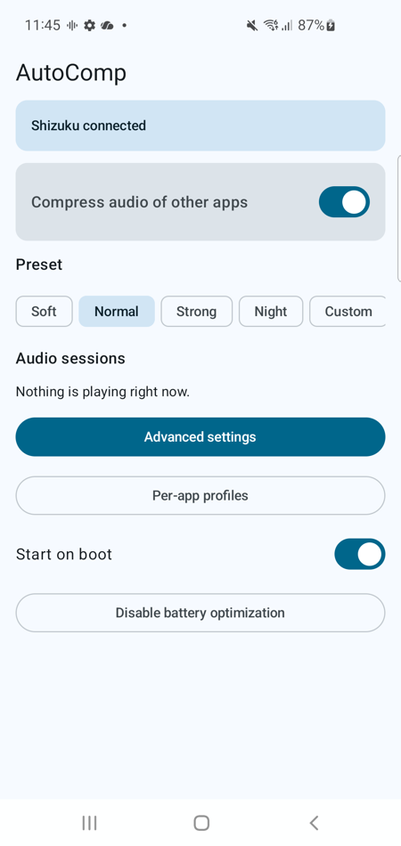
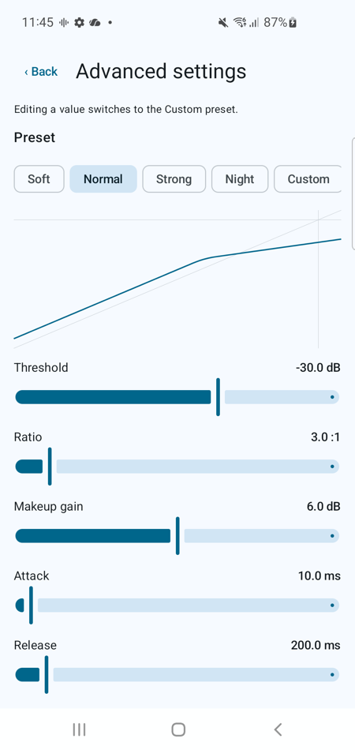
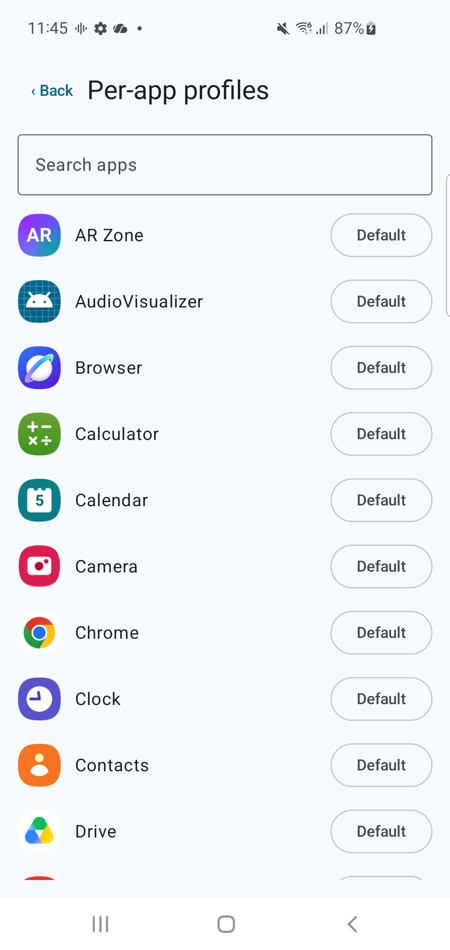

# AutoComp

**Real-time audio compressor for Android.** Badly mixed media (loud music and sound effects, quiet voices)?
AutoComp attaches a compressor + limiter to the audio of your other apps, so you only hear the processed sound.

<p>



</p>

## Features

- Global on/off with presets: **Soft / Normal / Strong / Night**
- Manual compressor: threshold, ratio, attack, release, knee, makeup gain, output limiter
- **Multiband** (6 bands) editor, live transfer curve
- **Per-app profiles**: default, bypass, or any preset per application
- Foreground service with notification action, **Quick Settings tile**, start on boot
- Live output level per playing app
- English and French UI, Material 3 with dynamic colors
- No network access, no analytics, no data collected

## How it works (and what you need)

Android does not let normal apps change other apps' audio. AutoComp creates an Android
`DynamicsProcessing` audio effect on each playing audio session. Discovering those sessions
requires elevated privileges, which [**Shizuku**](https://github.com/RikkaApps/Shizuku) provides **without root**.

1. Install Shizuku and start it (Android 11+: Wireless debugging, no PC needed; Android 9–10: one ADB command from a PC).
2. Install the AutoComp APK from the [Releases](../../releases) page.
3. Open AutoComp, grant it access to Shizuku, switch it on.

Requirements: Android 9+ (API 28). Developed and tested on a Samsung Galaxy S10 (Android 12).

### Known limitations

- Shizuku must be running; after a reboot it has to be started again (except with root or Android 11+ wireless-debugging auto-start).
- Apps that do not expose a regular audio session id (some games / low-latency AAudio paths, system sounds) are not processed.
- A compressor cannot separate voice from music: it evens out overall loudness. It cannot isolate dialogue.
- If AutoComp is killed while compressing, Android may keep the last effect on the current session until that player restarts.
- The meter shows output peak level, not gain reduction (the system effect does not report it).

## Build

```
./gradlew assembleDebug        # debug APK
./gradlew test                 # unit tests
```
Release signing reads `keystore.properties` (git-ignored) or `~/.android/autocomp/keystore.properties`.

License: GPL-3.0. See [docs/PLAN.md](docs/PLAN.md) and [docs/FINDINGS.md](docs/FINDINGS.md) for design notes.

---

# AutoComp (FR)

**Compresseur audio temps réel pour Android.** Médias mal mixés (musique et effets trop forts, voix trop basses) ?
AutoComp attache un compresseur et un limiteur au son de vos autres applications : vous n'entendez que le son traité.

## Fonctionnalités

- Activation globale avec préréglages : **Doux / Normal / Fort / Nuit**
- Compresseur manuel : seuil, ratio, attaque, relâchement, coude, gain de compensation, limiteur de sortie
- Éditeur **multibande** (6 bandes), courbe de transfert en direct
- **Profils par application** : par défaut, ignorée, ou n'importe quel préréglage
- Service au premier plan avec action dans la notification, **tuile Réglages rapides**, démarrage au boot
- Niveau de sortie en direct par application
- Interface en anglais et en français, Material 3 avec couleurs dynamiques
- Aucun accès réseau, aucune collecte de données

## Fonctionnement et prérequis

Android ne permet pas à une appli normale de modifier le son des autres. AutoComp crée un effet audio
`DynamicsProcessing` sur chaque session audio en lecture. Les repérer nécessite des privilèges que
[**Shizuku**](https://github.com/RikkaApps/Shizuku) fournit **sans root**.

1. Installez Shizuku et démarrez-le (Android 11+ : débogage sans fil, sans PC ; Android 9–10 : une commande ADB depuis un PC).
2. Installez l'APK d'AutoComp depuis la page [Releases](../../releases).
3. Ouvrez AutoComp, accordez-lui l'accès à Shizuku, activez-le.

Prérequis : Android 9+ (API 28). Développé et testé sur un Samsung Galaxy S10 (Android 12).

### Limites connues

- Shizuku doit tourner ; après un redémarrage il faut le relancer (sauf root ou démarrage auto par débogage sans fil sur Android 11+).
- Les apps sans identifiant de session audio classique (certains jeux / chemins AAudio basse latence, sons système) ne sont pas traitées.
- Un compresseur ne sépare pas la voix de la musique : il égalise le volume global, il n'isole pas les dialogues.
- Si AutoComp est tuée en cours de compression, Android peut garder le dernier effet sur la session en cours jusqu'à la relance du lecteur.
- L'indicateur montre le niveau de sortie (crête), pas la réduction de gain (l'effet système ne la fournit pas).

## Compilation

```
./gradlew assembleDebug        # APK debug
./gradlew test                 # tests unitaires
```
La signature release lit `keystore.properties` (ignoré par git) ou `~/.android/autocomp/keystore.properties`.

Licence : GPL-3.0.
